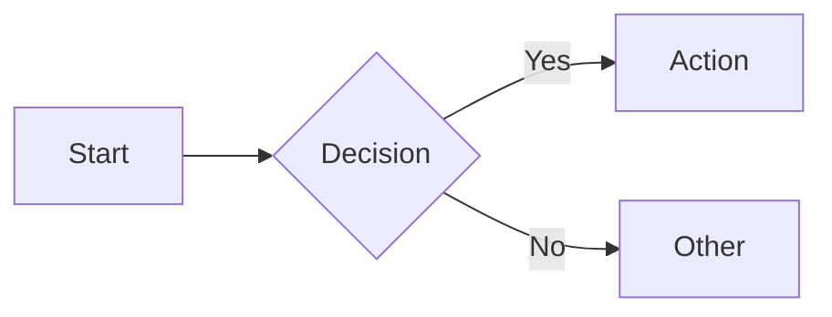

# Course Creator

Create structured training courses for the mycourse.work platform with rich markdown content, interactive quizzes, and mermaid diagrams.

The course format is **module-first** (format v1). The JSON Schemas are in `schema/` in this repo, and `schema/RULES.md` lists every rule. The old one-folder-per-course layout with `module|||lesson` ids is legacy: don't author new content in it.

## Workflow

1. Gather requirements (topic, audience, scope, modules)
2. Create one folder per module under `modules/`, each with a `manifest.json`
3. Write lesson markdown files and quiz JSON files in the module folders
4. Create `courses/<course-id>/course.json` listing the module ids in order
5. Add assets (images in each module's `assets/`, shared widgets in `widgets/`)
6. Validate: `python3 course-validator/scripts/validate_course.py <repo>` (see the course-validator skill)
7. Open a pull request on the tenant's content repo (`mycourse-work/<tenant>`). Merging to `main` publishes the course.

## Repository Structure

```
<tenant repo>/
├── courses/
│   └── ai-for-business/
│       ├── course.json
│       └── welcome.md
├── modules/
│   ├── ai-basics/
│   │   ├── manifest.json
│   │   ├── 01-what-is-ai.md
│   │   ├── 02-using-ai-safely.md
│   │   ├── quiz.json
│   │   └── assets/
│   │       └── diagram.webp
│   └── ai-at-work/
│       └── ...
└── widgets/
    └── prompt-builder.html
```

**Naming rules:**
- Course and module ids: lowercase kebab-case (`ai-for-business`). **The folder name must equal the id.**
- Lessons: `NN-short-title.md`. Quizzes: `quiz.json`.
- Don't rename an id after publishing: learner progress is stored against it.

## Manifests

See [references/manifest-schema.md](references/manifest-schema.md) for `course.json` and the module `manifest.json`. Key rules:

- `course.json` has `id`, `title`, `description` and `modules` (module ids in order)
- The quiz pass mark is set once per course: `quizPassingThreshold` (default 80)
- Module lessons have `id`, `title`, `type` (`content` or `quiz`) and a path. Do not use `section`: the learner player shows it as an empty lesson
- Paths are **relative to the module folder**: `"markdownPath": "01-what-is-ai.md"`. Never `/courses/...`
- Lesson ids are plain (`what-is-ai`). The platform adds the module prefix itself

## Lesson Content

Lessons are markdown files. The platform renders them with rich features.

### Basic Structure

```markdown
# Lesson Title

Introduction paragraph.

## Learning Objectives
- Objective 1
- Objective 2

## Main Content

Paragraphs, lists, links, bold, italic — all standard markdown.

## Key Takeaways
- Summary 1
- Summary 2
```

**Rules:** The first line is `# Title`. **No front matter** (`---` block): the player shows the raw file, so it would appear as text. Start with H1. Don't skip heading levels (H2 to H4 without H3). Target 800-1500 words per lesson.

### Callout Blockquotes

The first bold word determines the style:

```markdown
> **Tip:** Green callout with lightbulb icon.

> **Warning:** Amber callout with triangle icon.

> **Important:** Purple callout with star icon.

> **Danger:** Red callout with alert icon.
```

Keywords: `Tip`/`Hint` (green), `Warning`/`Caution` (amber), `Important`/`Key` (purple), `Danger`/`Error` (red). Any other first word renders as blue info.

### Code Blocks

Fenced code blocks with language tag get syntax highlighting (Shiki, github-dark theme) and a copy button.

Supported languages: javascript, typescript, python, html, css, json, markdown, bash, shell, vue, jsx, tsx, sql, yaml, go, rust, java, c, cpp, csharp, php, ruby, swift, kotlin.

### Mermaid Diagrams

Use fenced code blocks with `mermaid` language:

````markdown

````

All standard mermaid types work: flowchart, graph, sequence, class, state, mindmap, etc. Diagrams render with an expand-to-fullscreen button and zoom/pan controls.

### Math (KaTeX)

Inline: `$E = mc^2$`
Display block: `$$\sum_{i=1}^{n} x_i$$`

### Images

```markdown

```

Images are lazy-loaded, responsive, and rendered with rounded corners. Place files in the module's `assets/` folder and always link them with `./` (`./assets/x.webp`). Only `./` is relative to the lesson: the player resolves a bare `assets/x.webp` or `../assets/x.webp` under the **course** folder, so it breaks for a module. The validator fails a link to a file that does not exist, resolved the way the player does.

### Video Embeds

YouTube/Vimeo via iframe directive:

```markdown
:::iframe
https://www.youtube.com/embed/VIDEO_ID
:::
```

Vimeo URLs in standalone links are also auto-embedded.

### Tables

Standard GFM tables with sticky headers, zebra striping, and hover highlighting:

```markdown
| Header 1 | Header 2 |
|----------|----------|
| Cell 1   | Cell 2   |
```

### Task Lists

```markdown
- [x] Completed item
- [ ] Pending item
```

### External Links

Standalone links on their own line render as preview cards with domain badges. All external links open in new tabs.

## Widgets and Reflections

Embed a shared widget from `widgets/<name>.html`:

```markdown
:::widget prompt-builder
title: Prompt Builder
description: Build a prompt one step at a time.
:::
```

`title:` and `description:` make the activity card on phones. A widget must post `{type: "widget-ready"}` when it has loaded. See the player spec `docs/widget-focus-mode.md` in `mycourse-work/course.platform` for the full protocol.

A reflection asks the learner to write before seeing a model answer. Its `data-id` must be unique across the course:

```html
<div class="reflection" data-id="ai-basics-first-use" data-min-chars="50">
<div class="reflection-prompt">Where could AI save you an hour this week?</div>
<div class="reflection-answer">

**Model response:** ...

</div>
</div>
```

## Quizzes

See [references/quiz-schema.md](references/quiz-schema.md) for the full quiz JSON format with examples of all three question types.

**Key points:**
- The quiz file has `"type": "quiz"`, a `title` and `questions`
- Three types: `MULTIPLE_CHOICE`, `MULTIPLE_RESPONSE`, `MATCHING`
- Use `correct: true/false` (never `isCorrect`)
- Put the explanation in the question's `feedback`. Answer-level feedback is never shown
- Answer IDs: `{questionId}_{letter}` (e.g. `q1_a`, `q1_b`)
- 5-10 questions per module quiz. Mix question types for engagement
- **Don't add `passingScore`.** The pass mark is `quizPassingThreshold` in `course.json`

## Validation

```bash
python3 path/to/validate_course.py <repo-root>                 # everything
python3 path/to/validate_course.py courses/ai-for-business     # one course and its modules
```

It checks the manifests, ids, file paths, lesson markdown (title line, no front matter, links, widgets, reflections) and quizzes. Fix every error before you open the pull request. See the course-validator skill.

## Publishing

Open a pull request on the tenant content repo. Its `validate.yml` check runs the validator on the changed courses and modules. When the pull request is merged to `main`, the sync workflow uploads the files and registers the course. There is no zip step for module-first content (the admin zip import is only for legacy courses).
